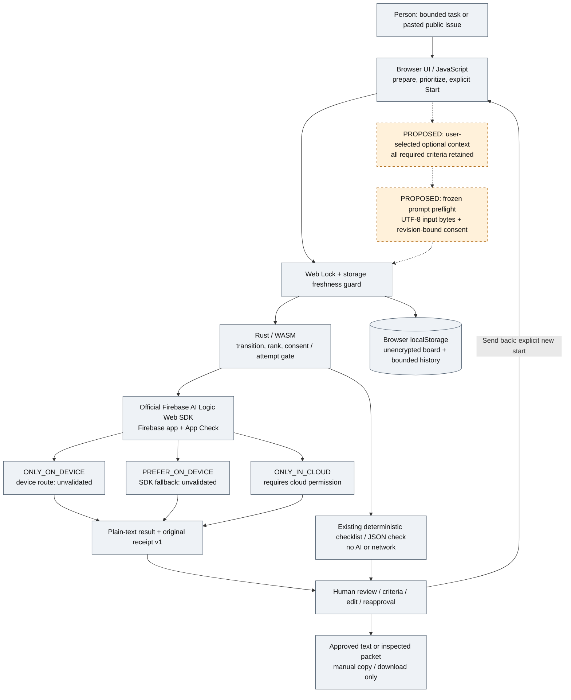

# Relay architecture: implemented boundaries and proposed additions

Design review: **November 13, 2026**. Source baseline: `0dc78e28e70ce5a89be6e46346d5780d21fd915d` (main after PR #8).

**This is a documentation-only design, not a feature release or new runtime validation.** Sections marked **proposed** or **deferred** are entirely unimplemented. The existing app remains a bounded browser drafting/review workboard, not an autonomous coding agent.

**Research access limitation:** [DLite v1](https://arxiv.org/abs/2610.23787v1) was reviewed as HTML text, including sections, equations, tables and appendix; PDF page mapping and figure images were not independently inspected. For [the far-edge paper v1](https://arxiv.org/abs/2610.14815v1), **only the abstract was reviewed as evidence; the full-text review is incomplete**. Its methods, results tables, deployment code and appendices are not verified here. The transferable ideas below are Relay design proposals, not replications of either paper.

## 1. Product contract and delivery order

A person prepares a small public/non-sensitive task, chooses its inference route, explicitly starts execution, reviews the text and decides whether to approve, revise or manually hand it off. AI produces plain text only. Relay does not execute the resulting instructions, contact another agent, operate GitHub, send messages or publish work.

Keep three independent decisions visible:

| Decision | What it authorizes | What it does not authorize |
| --- | --- | --- |
| Cloud permission before an eligible call | Sending the task's covered inputs to Google through Firebase AI Logic, including possible hybrid fallback | Approval of an answer, blanket future payload consent, or permission for tools |
| Human content approval after a result | Marking the current text as reviewed locally; unresolved criteria need explicit acknowledgment and a reason | Correctness, tested implementation, actual completion of the described work, or further inference |
| Manual copy/download after approval | Inspecting/copying the approved text or requesting the inspected packet file | External delivery, downstream execution, automatic upload, or confirmation that a browser saved the file |

**Priority remains: app usage guide → actual device/hybrid validation → submission preparation last.** The guide and validation remain outstanding; this design does not complete or silently replace them. Implementation and live validation stay on hold while the runtime is repaired. This document is not an instruction to resume them automatically.

## 2. Overall system

Solid arrows and gray nodes describe existing code paths, **not proof that every route works on hardware**. Dashed arrows and orange nodes are proposed local preparation steps; they do not exist in the app. Firebase routes are mutually selected for a call, not a pipeline that sends a device draft to a cloud verifier.



### Implemented components and data path

1. **Intake and UI:** Vanilla JavaScript/Vite renders the English board. Users add ordinary title/brief tasks or paste a public issue into a deterministic, editable local proposal. No issue URL is fetched. Issue intake stores reviewed goal, constraints and acceptance criteria inside a bounded brief, not raw pasted source or ignored fields. New issue tasks start device-only with cloud permission off. [Intake source](../src/issue-intake.js), [board](../src/main.js).
2. **State and ownership:** JavaScript owns DOM rendering, persistence and SDK integration; Rust/WASM owns deterministic transitions, priority/FIFO rank and a consent/session-attempt gate. Missing/outdated WASM selects a labeled JavaScript preview core and disables task execution. WASM is not a model, inference accelerator or Rust-rendered UI. [Core](../core/src/lib.rs), [policy](../src/policy.js), [locks](../src/board-lock.js).
3. **Explicit execution:** Start queue uses priority/FIFO order; Run this task only selects one queued ID and then pauses. Both use the same lock, freshness checks, route consent, attempt counter and receipt path. Successful results go to review, never straight to done. [Single-task behavior](SINGLE_TASK_EXECUTION.md).
4. **SDK boundary:** Firebase is dynamically imported at queue start (or an explicit initialization action). App Check initialization, attestation verification, device availability and inference are separate operations. `local → ONLY_ON_DEVICE`, `hybrid → PREFER_ON_DEVICE`, `cloud → ONLY_IN_CLOUD`. Hybrid catches device-initialization failure to permit SDK fallback; it is not a second application-managed generation or an automatic retry. All AI generation uses `generateContent` through Firebase AI Logic; no direct model HTTP route, AWS service or custom inference server is present. [AI boundary](../src/ai.js).
5. **Prompt and output:** The current prompt consists of fixed drafting instructions plus JSON containing title, brief and optional revision feedback. A revision is a fresh draft: previous outputs, archived history and receipts are **not** sent. Output is plain text displayed with `textContent`; it cannot execute tools. [Prompt](../src/draft-prompt.js).
6. **Review and provenance:** Criteria extracted from issue briefs are assessed by the human as addressed/missing/unverified; approval with unresolved items requires an acknowledgment and reason. Local human edits keep original text/source/receipt, clear prior approval and criteria assessment, and require reapproval. Ordinary free-form briefs do not automatically acquire structured criteria. [Criteria](../src/criteria-review.js), [editing](../src/review-edit.js).
7. **Handoff:** Approved text and `relay-approved-handoff-v1` JSON preserve the stored request, criteria assessment, original text, approved text and original-run evidence. The packet is an unsigned local snapshot, not execution authority. Download rechecks the current approved version and board freshness. A saved snapshot is not synchronized or revoked by later changes. [Packet](../src/handoff-packet.js), [download limits](HANDOFF_DOWNLOAD.md).

### Storage, limits and failure handling

| Boundary | Existing behavior and limitation |
| --- | --- |
| Board | `relay-board-v1` in localStorage; at most 100 tasks. Unencrypted, browser/origin-scoped, not cloud synchronization or a secure secret store. Browser clearing, eviction and quota limits can lose data. |
| Inputs | Title ≤160, brief ≤4,000, optional revision feedback ≤2,000 JavaScript string-length units. Issue fields: goal ≤1,600, constraints ≤800, criteria ≤800; final escaped brief must still fit 4,000. These are **not byte or token limits**. |
| Output | Cloud requests set `maxOutputTokens: 1200`; on-device has no equivalent configured cap. Displayed AI text is truncated to 20,000 string units. Neither bound guarantees quality or a monetary ceiling. |
| History | Sent-back history: up to 3 entries/task; each original-text and edited-text excerpt is separately capped at 8,000 string units, with an 80,000-unit aggregate text/feedback/edited-text budget across board history. Pruning and shortening are disclosed, not lossless archival. [Source](../src/draft-history.js). |
| Concurrency | One exclusive Web Lock and serialized board writes across cooperating tabs sharing the origin/storage scope. A stale snapshot refuses a write and refreshes. No cross-browser/device lock, distributed transaction or exactly-once guarantee. |
| Attempts and pause | Gate at six counted AI attempts per page session, not global/cloud quota or billing protection. Pause takes effect after the active call; it cannot cancel/refund a request. Local deterministic work is not AI success. |
| Failure/reload | Failure blocks the task and stops the queue; explicit Return to queue and Start are needed. Reloaded running tasks become blocked because a previous call may have consumed quota. No automatic retry, offline outbox or background replay. |
| Storage failure | Persistence errors stop further execution and advise export. Invalid saved data shows samples without overwriting original storage until a later user change. This is not a verified crash-safe backup mechanism. |

Local-only inference mode is a routing request, **not a blanket zero-network or privacy guarantee**: Firebase/App Check setup and model preparation have their own dependencies. Browser/OS support, model readiness, tab lifetime, model download size and connectivity can prevent use. Availability checks alone do not prove inference readiness or success.

## 3. Current vs proposed vs deferred

“Implemented” below means present in reviewed source, not newly tested or deployed. No new behavior is delivered by this documentation change.

| Capability | Implemented at baseline | Proposed, wholly unimplemented | Deferred / not adopted |
| --- | --- | --- | --- |
| Route choice | Per-task mode and `cloudAllowed` boolean; changed revision feedback clears cloud permission; execution settings show covered title/brief/feedback | Bind permission to a frozen request revision, exact rendered prompt and selected route | Broad reusable consent or automatic off-device rerouting |
| Prompt scope | Fresh bounded title/brief/feedback; no full history or old output | Show required fields plus explicitly selected optional excerpts; deterministic preview only | Automatic summarization, memory retrieval, extra model call or receipt/history injection |
| Criteria | Issue-intake criteria retained in brief; human content assessment and reasoned override | Stable criterion IDs and exact coverage check in every planned payload; no criteria selection/removal | Treating human approval as token verification or completed implementation |
| Preflight bytes | No prompt-byte diagnostic recorded | Exact UTF-8 count of the frozen prompt sent to `generateContent`, with measurement boundary labeled | Equating prompt bytes to wire traffic, tokens, price, energy or privacy |
| Original-run evidence | Strict four-field receipt v1; original text/source/time survive local edits/history/packet | Separate versioned request-plan sidecar, linked only for future runs if implemented | Retrofitting old results or adding fields to v1 without migration |
| Receipt evolution | requestedMode, actualSource, elapsedMs; unknowns preserved | No v2 required for initial preflight | Optional v2 only after a separate compatibility review and genuinely observable fields |
| Failure/resume | Explicit requeue; blocked interrupted work; no retry | Keep these stops across new consent/payload flow | Background retry, auto-send/outbox and inferred fallback reasons |
| Handoff | Human-approved packet/text, manual local download/copy | Future user-selected approved excerpts could be a separate reviewed task input | Agent invocation, automatic context sharing or external delivery |
| Device/cloud validation | Historical cloud/review observations; failed Brave device attempt | Baseline device success and hybrid source observation need real acceptance later | Claiming hardware support from graphics specs, diagnostics or stored receipts |
| DLite / far-edge technology | No speculative decoding or IoT runtime | Borrow boundary clarity and disciplined comparisons, not internals | Hidden-state drafter training, token verification, KV control, Qwen serving, AWS/Greengrass infrastructure |

**Evidence status:** [LIVE_VALIDATION.md](LIVE_VALIDATION.md) contains dated historical cloud observations and a failed Windows/Brave device attempt. Some older summaries say “one cloud response” while later entries describe another public-issue flow; do not turn those summaries into a newly verified cumulative count. Device and actual hybrid fallback remain **unvalidated**. Receipts loaded from storage do not establish availability in a new session. Historical offline test/build records are not current executions.

## 4. Paper transfer matrix

Both links are pinned to **v1**, not a moving latest revision. No paper throughput, latency, bandwidth, cost or privacy result is a Relay result. No reproducibility experiment was run.

| Source and exact review scope | Paper mechanism or boundary | Feasible Relay transfer | Excluded inference |
| --- | --- | --- | --- |
| [DLite §2.1, Eq. (1)](https://arxiv.org/html/2610.23787v1#S2.SS1); HTML text reviewed | Speedup depends on accepted draft length and both drafting and target-verification time | Define measurement boundaries; assess quality and whole-operation time separately | A high token acceptance length means better drafts, or a predicted Relay speedup |
| [DLite §3.1–3.2](https://arxiv.org/html/2610.23787v1#S3); HTML text reviewed | Growing history can burden speculative drafters | Keep Relay's existing fresh prompts; make selected inputs inspectable before considering any reduction | Relay currently resends full history, or has the paper's measured KV overhead |
| [DLite §4.1.1, Eq. (2)](https://arxiv.org/html/2610.23787v1#S4.SS1.SSS1); HTML text reviewed | Target still processes full history and keeps its KV; drafter uses target hidden states and local placeholders without history KV | Explain retained required task context versus optional extras as an **application-level analogy only** | Text excerpts/summaries are hidden states, or “history-free” means discarding required context |
| [DLite §4.1.2, Eqs. (3)–(5)](https://arxiv.org/html/2610.23787v1#S4.SS1.SSS2) and [§4.2, Eqs. (6)–(7)](https://arxiv.org/html/2610.23787v1#S4.SS2); HTML text reviewed | Recurrent draft head and two-stage teacher/drafter alignment require training and inference-engine integration | Mark the SDK boundary explicitly: Relay exposes none of these controls | Device draft → cloud rewrite or human approval implements speculative token verification |
| [DLite §5 and Appendix A](https://arxiv.org/html/2610.23787v1#S5); text/tables and appendix reviewed, figure images not checked | Qwen/H800 decoding/throughput and long-context workloads; tool execution is excluded from the described BFCL timing | Use appropriate baselines; distinguish generation, preparation and human work; do not infer end-task completion from decoding metrics | Transfer GPU speedups, acceptance lengths or benchmark names into Relay efficacy claims |
| [Far-edge v1 abstract ONLY](https://arxiv.org/abs/2610.14815v1); full-text review incomplete | Authors describe industrial predictive maintenance using AWS IoT/Greengrass local inference and selective cloud synchronization | Design analogy: user-selected payload, explicit route boundaries, compare equal tasks and label timing/byte boundaries | AWS latency/bandwidth/F1 outcomes apply to browser LLM generation; model/deployment methods were reviewed |
| [Same abstract ONLY](https://arxiv.org/abs/2610.14815v1) | Disconnection uptime/queue instrumentation is described; quantitative disconnection experiments are stated as planned work | Document failure/reload behavior and plan separate future recovery evaluation | Empirically proven offline resilience for either Relay or the paper's planned experiment |

The far-edge abstract's quoted percentage and displayed bandwidth endpoints do not directly reconcile; its cloud-round-trip and local-inference timings also have different labels. Full-text methods and measurement boundaries must be checked before interpreting those comparisons. This design intentionally imports **no numerical performance claims**. It also makes no claim about the unread paper's algorithms, hardware, appendix code or federation implementation.

**Why not implement DLite here?** Firebase AI Logic's current app boundary provides prompts, text and reported inference source, not target hidden states/logits, trained compatible drafters, block verification or KV-cache control. DLite's target/drafter architecture is not Firebase's device/cloud route selection. No AWS, Qwen, custom serving, model training or new provider dependency is proposed.

## 5. Proposed bounded payload and preflight — UNIMPLEMENTED

Goal: help the user inspect exactly what a future call will use, without adding inference calls or quietly changing task requirements. This is not a claim that shorter input always helps. Existing prompts already omit conversation history.

### Request preparation

1. Start from the current reviewed task, not a reconstruction of raw issue text. Preserve the full required title, goal/brief, constraints, **every acceptance criterion**, and current revision feedback. For free-form tasks, require the person to identify/confirm required content before offering optional context selection; do not invent structured criteria with an AI call.
2. Only **optional supplementary excerpts** can be selected/omitted. Show their origin and exact text. Initial scope may simply retain the existing full brief; if no optional material exists, there is nothing to remove. Do not select criteria, silently compress text, auto-summarize prior drafts or suggest that omissions anonymize data.
3. Reuse existing limits: title 160, rendered brief 4,000 and feedback 2,000 string units, with existing issue-field limits where applicable. Optional excerpts count **inside**, not in addition to, the brief budget. Reject over-limit input and ask for explicit user editing; never truncate required content to fit. Preserve criterion IDs/order/text and verify complete required-field coverage.
4. Render one deterministic prompt from a versioned template. Show its exact text, required-content coverage, selected/omitted optional context, route and output-limit wording. Do not include local provenance/consent/diagnostic metadata in the model prompt.
5. Count the exact UTF-8 encoded prompt string, after JSON escaping/template rendering and before the SDK call: conceptually `TextEncoder().encode(frozenPrompt).byteLength`. Reuse **that same frozen string** at execution, not an independently rebuilt approximation. This is a design formula, not executed measurement or new code.
6. Present “Input prompt: N UTF-8 bytes” only when measured. Unknown/unavailable measurement remains unknown, not zero. The count excludes SDK envelopes, headers, App Check traffic, transport encoding/compression, model downloads and responses. It is neither wire bytes, tokens nor cost. If the prompt is unchanged, a UI-only preflight improvement does not need a fabricated A/B inference experiment.

### Revision-bound cloud permission and dispatch

- A future cloud/hybrid permission should bind one planned attempt to the task revision, frozen prompt identity, template version, requested route and relevant model/config identity. The person sees the covered text and Google/Firebase destination. Local mode has no cloud permission and must never fall back.
- Editing required text, optional selection, feedback, template, route or relevant model configuration invalidates the plan and permission. Define one canonical, versioned identity envelope covering task revision, selected-input identity, template, requested route, model/config identity and frozen prompt; exclude consent and diagnostic fields from that digest to avoid recursive identity. A changed hash alone is not a substitute for a reviewable diff. A digest is local equality bookkeeping, **not** signed consent, identity authentication or an attestation.
- Keep permission, content review and manual export separate. Preflight confirmation neither approves an answer nor authorizes a downstream tool.
- Under the existing exclusive lock, check board freshness, plan revision, exact prompt equality, route, permission and session-attempt cap again immediately before preparation/dispatch. Persist the attempt's pending/in-flight state before the external call; a reload/unknown outcome remains blocked rather than automatically resent.
- Consume the permission for that planned attempt. Another try after failure/requeue needs a fresh inspected plan and cloud confirmation. Do not replay an unknown request, generate a summary first, or turn device failure into a second application-managed cloud call.
- Continue using Firebase's selected route for the single generation call. Record actual source only when the SDK reports it. A device-preferred response served in cloud does not reveal the fallback reason.
- These are **new design invariants**, not guarantees of the current `cloudAllowed` boolean implementation.

### Versioned schema sketch — NOT an accepted runtime format

The following is a conceptual field/type contract for a **new, separate local plan sidecar**. All names, validation, storage and integration below are unimplemented. It is not JSON to import into the app, not an example of a completed run, and not a schema change to receipt v1.

```text
RequestPlanDraft
  format: "relay-request-plan-v1"                 # proposed namespace only
  taskId: string
  taskRevision: integer                         # new revision mechanism, not present today
  templateVersion: string
  requestedMode: "local" | "hybrid" | "cloud"
  modelConfigIdentity: string                    # no credential values
  required:
    title: string
    goalOrBrief: string
    constraints: string                         # explicit empty allowed if reviewed
    acceptanceCriteria: [{id: string, text: string}]
    revisionFeedback: string                    # explicit empty if none
  optionalContext:
    [{id: string, originRef: string, text: string, selected: boolean}]
  coverage:
    requiredFieldRefs: [string]
    requiredCriterionIds: [string]               # must equal ALL required criterion IDs
  frozenPrompt: string                          # rendered model input, not metadata above
  promptIdentity: string                         # digest of versioned frozen-plan envelope
  inputDiagnostics:
    version: 1
    boundary: "generateContent-prompt-utf8"
    promptUtf8Bytes: nonnegative integer | null  # null = not measured/unknown
  cloudConsent: null | {
    version: 1, taskRevision: integer, promptIdentity: string,
    requestedMode: "hybrid" | "cloud", modelConfigIdentity: string,
    destination: "Google via Firebase AI Logic",
    scope: "one-planned-attempt", confirmedAt: timestamp
  }
```

Required content is represented once semantically: an implementation must not append a second copy of already embedded issue JSON/criteria. Rendering rules must preserve every required item and show the result for inspection. `originRef` identifies a local reviewed excerpt, not a URL-fetch instruction, trusted author identity or an external send destination. Optional context initially excludes automatic history retrieval; copying an approved artifact into a new task would require a separate explicit feature/review.

**Attempt linkage, also proposed:** a local attempt record could link an immutable plan identity to pending/succeeded/failed/interrupted-or-unknown disposition and the new result's original receipt. Pending is not success. Preserve unknown outcomes without retries; avoid raw SDK errors or sensitive prompt text in public exports. Linkage and future storage bounds/validation need a separate implementation review; do not treat the sketch as a durable audit or exactly-once protocol.

## 6. Evidence compatibility and optional receipt evolution

**Keep existing receipt v1 unchanged:**

```text
{ version: 1,
  requestedMode: "local" | "hybrid" | "cloud",
  actualSource: "on_device" | "in_cloud" | "UNKNOWN",
  elapsedMs: nonnegative integer | null }
```

[The current validator](../src/execution-receipt.js) accepts exactly those four fields. Successful new AI drafts get this local receipt; legacy results, deterministic local output and fixtures must not acquire one. `elapsedMs` covers model preparation/readiness, generation/response and client overhead from the existing boundary. It is not model-only latency, TTFT, token use or charge. Unrecognized/missing source remains UNKNOWN, non-measurable elapsed time remains null. Exclusive-route contradictions are warnings, not silently corrected success.

A proposed request plan should remain a separate, versioned entity; it must not be smuggled into v1 or appended to its prompt. Later review could design a **receipt v2 or a separately versioned evidence envelope** linking the original request-plan identity and measured input-prompt bytes. That evolution is deferred, optional and not required for a local preflight UI.

Compatibility requirements for any later evolution:

- Read old boards/results/history/packets without manufacturing plan IDs, source, fallback reasons or measurements. Missing plan/evidence means not recorded.
- Preserve receipt v1 as originally observed through local human edits and sent-back history. A changed requested route for the next attempt cannot rewrite the old run.
- Do not add synthetic fallback reasons, TTFT, generation-only time, tokens or cost. Introduce a future field only with an actual observation boundary and unknown representation; no estimate from character count or configured caps.
- Version and review board storage, strict validators, bounded history and packet export together before writing a new format. An old app must refuse unsupported new data rather than silently discard it. No migration or dual-writer protocol has been implemented.
- Keep `relay-approved-handoff-v1` unchanged for this design. New plan export would require a separately reviewed packet version and clear disclosure of exactly which selected input/original-run evidence it contains.
- Keep the original source, original creation time, immutable generated text and subsequent human edit/approval distinct. Local timestamps and hashes are not signatures or remote execution proofs.

## 7. Evaluation plan ONLY — no execution authorization

No new tests, builds, browser/model probes, inference or paid API calls were run for this documentation. The existing Relay development allowance remains **exhausted at 10 case executions / 3 test invocations**; this plan grants no additional allowance or automatic resumption.

Future evaluation requires runtime readiness, an explicitly scoped test allowance and applicable live-call authorization. Keep these stages separate:

| Future stage | Question and observation | Boundary / stop |
| --- | --- | --- |
| Source/fixture acceptance after implementation | Are all required fields/criteria retained? Do Unicode/JSON escaping, limits, plan invalidation, consent mismatch and stale-board stops behave correctly? | New focused cases must fit an agreed budget; no full-suite wrapper or invented “single test” count |
| Baseline device/hybrid acceptance | Can the actual supported device route generate? What source does hybrid really report? | Record SDK/browser/OS/device, requested route and actual observation. Availability/GPU specs and stored receipts do not suffice. UNKNOWN, errors and interrupted calls remain separate |
| Proposed payload comparison, only if prompt changes | Current fresh-prompt baseline vs selected-input variant on the same public/synthetic task; same required criteria, route and configured output cap | Do not compare against fabricated whole-history resends. Measure prompt UTF-8 bytes locally, not wire bytes. No omission justified solely by a smaller number |
| Product-route comparison | Device-only vs cloud-only on the same tasks; hybrid fallback observed as its own condition | Different models mean product-route comparison, not isolated networking effect. No unseen fallback reason |
| Useful output | Human assessment of criteria, errors/omissions, editing burden and unresolved-criteria overrides | Blind route where practical. Approval is content review, not implementation success or anomaly-classification F1 |
| Timing and reliability | Original whole-operation elapsed; predefine cold/warm and model-preparation conditions; include failed/unknown/interrupted attempts | No inferred TTFT or generation split. Preserve all observations; small samples do not justify p95 or general superiority |
| Failure/recovery and storage | No-consent stop, blocked interrupted work, manual requeue, stale tab, persistence limits | No auto-send/retry. Browser lifecycle and local storage are not an industrial always-on edge gateway |
| Cost, bandwidth, privacy and energy | Unmeasured unless directly instrumented/independently reviewed | Prompt bytes and six-attempt limits are not billing, wire traffic or privacy evidence. No paper-derived Relay savings |

Freeze tasks, order, required content and intended comparison before a future run; record SDK/model identification only to the extent actually exposed. Preserve raw original-run receipts plus human evaluation separately. Define acceptance thresholds before evaluation or label it exploratory; do not invent numeric performance targets from the papers. Do not run live comparisons when only navigation/wording changed.

## 8. Delivery phases and deployment constraints

| Phase | Deliverable | Status / gate |
| --- | --- | --- |
| 0 | This canonical architecture and explicit proposal/status boundaries | Documentation-only; does not release features |
| 1 | App usage guide / short English walkthrough of current prepare → run → review → handoff behavior | Outstanding implementation work; runtime repair wait remains. Do not show proposed controls as available |
| 2 | Actual device-only and hybrid validation of the current app, with recorded source and failures | Outstanding; needs supported runtime and scoped execution/testing. Historical cloud evidence is not a substitute |
| 3, optional | Small local-only preflight/byte diagnostic, then separately reviewed payload selection + revision-bound permission | UNIMPLEMENTED; after guide/baseline validation, subject to new scope/tests. Start with inspection of existing full payload; no added inference. May be deferred without blocking the core demo |
| 4, last | Submission preparation: honest demo, setup/access review, license decision and contest checklist | Not done; owner approval required for submission. No license is selected by this design |

The docs-only change requires **no runtime deployment, dependency, Firebase configuration, authorization, service, schema or model change**. Existing setup remains in [IMPLEMENTATION.md](IMPLEMENTATION.md). Vite is the browser build, Firebase is pinned to 13.0.0, and the generated WASM is ignored/not committed. A production build needs the compatible core, Firebase app/App Check setup and supported runtime; a successful preview build would not validate any of those.

Future plan storage must be bounded and reviewed alongside the existing brief/history caps. Do not persist another unbounded copy of prompts or raw issues. Storage remains unencrypted unless a separate feature changes it; a hash of text is not encryption. Provide a deliberate migration/unsupported-version story before schema changes, not an automatic rewrite of old evidence.

### Principal limitations and risks

- **Omitted context:** selecting optional excerpts can hide constraints or introduce stale facts. Required content and all criteria remain mandatory; show omissions and origins, keep the original task, and require the user's inspection.
- **Untrusted data:** pasted issues, copied artifacts and model output remain data, not instructions granting authority. Selection does not neutralize prompt injection or make sensitive text safe to send.
- **Consent drift:** task/template/model/route changes can outgrow a boolean permission. Revision-bound consent is a proposed improvement, not a present security guarantee.
- **Browser constraints:** tabs close, models may be unavailable, initialization can download large assets, App Check may fail and storage can fill. No promised offline availability or background completion.
- **Evidence and quality:** receipts are local/unsigned; human approval and route reporting do not establish factual accuracy or successful downstream work. No fresh hardware/runtime validation or generalized benefit is claimed.
- **Scope growth:** AWS/MLOps infrastructure, speculative decoding, automatic memory, extra calls or autonomous handoff would change the product. They are not dependencies of this plan.

## Related current behavior

[Setup/status](IMPLEMENTATION.md) · [Board workflow](BOARD_WORKFLOW.md) · [Original receipts](EXECUTION_RECEIPTS.md) · [Manual packet](HANDOFF_DOWNLOAD.md) · [Multi-tab safety](MULTI_TAB_SAFETY.md) · [Historical live evidence](LIVE_VALIDATION.md) · [Device diagnostics](DEVICE_DIAGNOSTICS.md)
